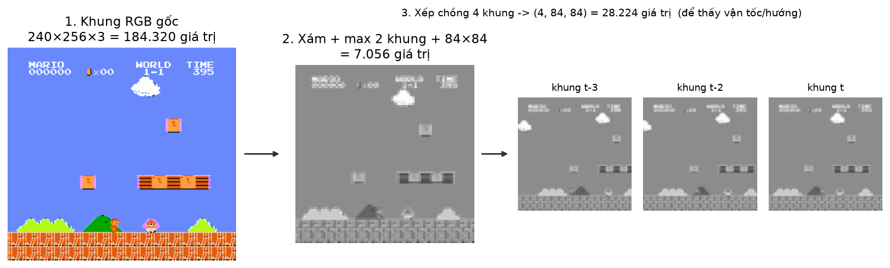
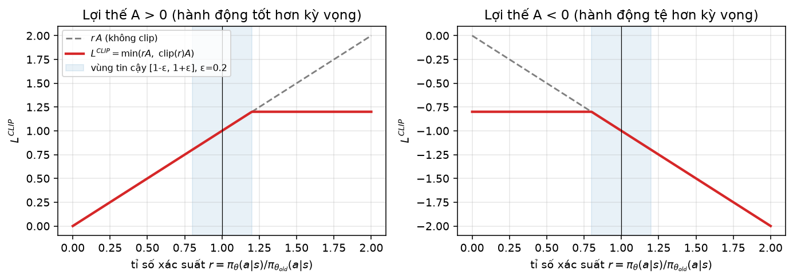
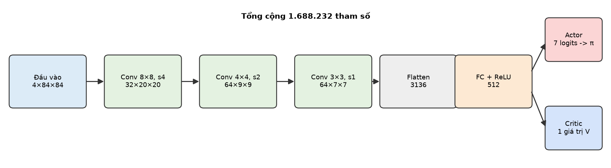
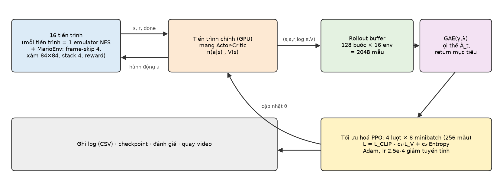

# Tác tử học tăng cường (PPO) tự chơi Super Mario Bros

**Báo cáo dự án: toàn bộ quá trình xây dựng, kèm lý thuyết từng phần**

Ngày lập: 14/10/2026 · Mã nguồn và dữ liệu: thư mục dự án (`D:\Mario`)

---

## Tóm tắt

Dự án xây dựng một tác tử học tăng cường tự chơi màn World 1-1 của Super Mario Bros chỉ từ điểm ảnh, bằng PPO viết từ đầu trong PyTorch. Báo cáo ghi lại toàn bộ quá trình và lý thuyết từng phần: MDP và POMDP, tiền xử lý quan sát (bỏ khung, xám 84×84, xếp chồng 4 khung), thiết kế phần thưởng (thưởng định hình dựa trên thế năng), và thuật toán từ policy gradient qua GAE đến hàm mục tiêu cắt của PPO, mỗi phần kèm ví dụ tính tay đã được kiểm thử bằng mã.

Kết quả đã có: môi trường chạy được trên Windows không cần Visual Studio (biên dịch lõi C++ bằng `ziglang`, vá cho NumPy 2); phần thưởng tính tay khớp với mô phỏng đến từng chữ số; và một chẩn đoán đáng giá: với thang phần thưởng 0,1 agent học rất chậm (value loss lớn gấp hàng chục nghìn lần policy loss), còn với 0,01 agent đạt khoảng 22% ván chạm cờ chỉ sau 600k bước (mục 7.2, số đo khi debug cục bộ). **Kết quả huấn luyện chính thức (đường cong học, đánh giá cuối, video) sẽ được chạy trên Colab bằng `colab_train.ipynb` và điền vào mục 7.5 đến 7.9**; các mục này hiện còn để trống và được đánh dấu rõ.

---

<a id="sec-doc"></a>
## 0. Hướng dẫn đọc: mục tiêu, mạch bài, phạm vi

**Sau khi đọc báo cáo này, bạn có thể:**

1. Mô tả trò chơi Mario như một *quá trình quyết định Markov* (MDP) và chỉ ra từng thành phần $(\mathcal S,\mathcal A,P,R,\gamma)$ bằng số liệu cụ thể của màn 1-1.
2. Giải thích vì sao phải bỏ khung hình (frame-skip), xếp chồng khung hình (frame-stack), thu nhỏ ảnh, và tính được kích thước của quan sát.
3. Tính tay phần thưởng của một ván chơi rồi đối chiếu với kết quả mô phỏng, khớp từng chữ số.
4. Suy ra gradient chính sách, ước lượng lợi thế tổng quát (GAE) và hàm mục tiêu cắt (clip) của PPO, và tính tay một ví dụ cho từng công thức.
5. Chạy lại toàn bộ dự án (cài đặt, huấn luyện, đánh giá, quay video) trên máy Windows không có Visual Studio.
6. Đọc các biểu đồ chẩn đoán (value loss, entropy, KL, clip fraction, explained variance) để nhận ra một lần huấn luyện kém và sửa nó, đúng như đã xảy ra trong dự án này.

**Mạch bài.** Báo cáo đi theo thứ tự một người thực hành sẽ làm: (1) nêu bài toán và *ví dụ xuyên suốt*; (2) nền tảng lý thuyết học tăng cường; (3) môi trường và tiền xử lý quan sát; (4) thiết kế phần thưởng; (5) thuật toán, từ policy gradient đến PPO; (6) triển khai; (7) thí nghiệm và kết quả; (8) thảo luận; (9) tài liệu tham khảo. Các mục 2 đến 5 là lý thuyết, mỗi mục luôn quay lại màn 1-1. Mục 7 đóng vòng: các con số tính tay ở mục 4 và mục 5 xuất hiện lại trong kết quả đo.

**Phạm vi không bao gồm.** Báo cáo không cài đặt các thuật toán dựa trên bộ nhớ phát lại (DQN, Rainbow; chỉ so sánh về lý thuyết ở mục 2), không học trực tiếp từ RAM của máy NES, không có học dựa trên mô hình (model-based), học đa tác tử, hay thưởng tò mò (curiosity, RND). Đây là những hướng mở rộng được nhắc ở mục 8.

**Quy ước nhãn.** Số liệu có nhãn **[ĐO THẬT]** lấy từ lần chạy thực tế (có file kèm theo). Ví dụ có nhãn **[MINH HOẠ]** do chúng tôi dựng để giải thích công thức, không phải kết quả chạy của agent; mọi ví dụ minh hoạ có kiểm thử đơn vị trong `tests/test_core.py` để chắc chắn phép tính tay khớp với mã.

---

<a id="sec-problem"></a>
## 1. Bài toán và ví dụ xuyên suốt: World 1-1

**Mục tiêu.** Huấn luyện một tác tử (agent) nhìn màn hình game như người chơi (chỉ có điểm ảnh, không đọc bộ nhớ) và tự điều khiển Mario đi từ điểm xuất phát đến lá cờ cuối màn *World 1-1* của Super Mario Bros (NES), không có dữ liệu mẫu từ người chơi, chỉ học bằng thử và sai.

**Hai điều trông giống nhau nhưng hành xử khác nhau** (mở đầu cho mạch bài, sẽ giải quyết ở mục 7). Một chính sách "luôn bấm phải" và một chính sách "luôn bấm phải rồi nhảy" đều đưa Mario đi thẳng về phía trước, nhưng cả hai chết ở cùng một chỗ (con Goomba đầu tiên, $x=296$) và nhận *cùng một phần thưởng thô* 231 **[ĐO THẬT khi debug]**. Một agent đã học cũng chỉ dùng các nút "phải, nhảy, chạy", nhưng bấm đúng lúc và giữ đúng độ dài. Học tăng cường chính là việc biến sự khác biệt "đúng lúc" này thành thứ tối ưu được.

**Ví dụ xuyên suốt.** Mọi mục lý thuyết đều dùng đúng một kịch bản: *World 1-1, ROM chuẩn, bộ hành động 7 nút, frame-skip 4*. Bảng dưới gom các con số cố định; các số có nhãn **[ĐO THẬT]** được đo từ chính môi trường của dự án.

| Đại lượng | Giá trị | Nguồn |
|---|---|---|
| Màn chơi | World 1-1, `SuperMarioBros-1-1`, ROM chuẩn | gym-super-mario-bros 7.4.0 |
| Tốc độ game | 60 khung hình/giây | NES (NTSC) |
| Toạ độ xuất phát của Mario | $x_0 = 40$ | **[ĐO THẬT]** đọc RAM sau `reset` |
| Toạ độ khi chạm cột cờ | $x_{\text{cờ}}=3\,161$ | **[ĐO THẬT]** hai ván về đích khi debug cùng cho 3 161 |
| Đồng hồ trong game | bắt đầu 400, giảm 1 mỗi 20 khung hình | **[ĐO THẬT]** (`tests`, mục 4) |
| Số hành động | 7 (`SIMPLE_MOVEMENT`) | mục 3 |
| Bỏ khung hình (frame-skip) | 4, tức 15 quyết định mỗi giây | mục 3 |
| Ảnh gốc | $240\times256\times3 = 184\,320$ giá trị | emulator |
| Quan sát của agent | $4\times84\times84 = 28\,224$ giá trị `uint8` | mục 3 |
| Độ dài tối đa một ván | $400\times20/4 = 2\,000$ bước agent | tính từ hai dòng trên; **[ĐO THẬT]** các ván hết giờ khi debug dài 1 998 đến 2 004 bước |
| Tham số của mạng nơ-ron | $1\,688\,232$ | mục 6 |

**Vì sao đây là bài toán khó cho học tăng cường.** Thứ nhất, *thưởng thưa và trễ*: chỉ khi sống sót qua cả màn mới có cờ, nhưng chết sớm lại phổ biến. Thứ hai, *khám phá có thứ tự*: độ cao cú nhảy phụ thuộc vào thời gian giữ nút A (đo ở mục 3: giữ 1 quyết định chỉ nhảy cao 2,06 ô, phải giữ ít nhất 3 quyết định liên tiếp mới vượt được chướng ngại cao 3 ô), nên một chính sách chọn hành động ngẫu nhiên độc lập từng bước hiếm khi tình cờ vượt được các ống cao. Thứ ba, *quan sát từng phần*: một khung hình tĩnh không cho biết Mario đang bay lên hay rơi xuống.

---

<a id="sec-theory-rl"></a>
## 2. Nền tảng lý thuyết học tăng cường

### 2.1 Vòng lặp tác tử và môi trường

Ở mỗi bước thời gian $t$, tác tử quan sát trạng thái $s_t$, chọn hành động $a_t$ theo *chính sách* (policy) $\pi(a\mid s)$; môi trường trả về phần thưởng $r_{t+1}$ và trạng thái kế tiếp $s_{t+1}$. Chuỗi $\tau=(s_0,a_0,r_1,s_1,a_1,r_2,\dots)$ gọi là *quỹ đạo* (trajectory); một quỹ đạo kết thúc ở bước $T$ khi gặp trạng thái kết thúc, và đó là một *ván* (episode).

> **Trong Mario 1-1.** Một ván bắt đầu khi `reset` và kết thúc khi Mario chết hoặc chạm cột cờ (mục 3). $s_t$ là chồng 4 khung hình xám; $a_t\in\{0,\dots,6\}$ là tổ hợp nút; $r_{t+1}$ là phần thưởng định nghĩa ở mục 4.

### 2.2 Quá trình quyết định Markov (MDP)

Một MDP gồm bộ năm $(\mathcal S,\mathcal A,P,R,\gamma)$:

- $\mathcal S$: tập trạng thái; $\mathcal A$: tập hành động.
- $P(s'\mid s,a)$: xác suất chuyển trạng thái. *Tính chất Markov* nói rằng tương lai chỉ phụ thuộc vào $(s_t,a_t)$ chứ không phụ thuộc lịch sử trước đó.
- $R(s,a,s')$: phần thưởng, và $\gamma\in[0,1]$: hệ số chiết khấu.

> **Trong Mario 1-1.** $\mathcal A$ có 7 phần tử. $P$ gần như *tất định*: emulator NES là một máy trạng thái, cùng trạng thái bộ nhớ và cùng nút bấm luôn cho cùng kết quả, kể cả bộ sinh số ngẫu nhiên của game (nó nằm trong RAM). Hệ quả quan trọng: mọi ván bắt đầu từ cùng một trạng thái nên tính ngẫu nhiên duy nhất đến từ chính sách. Mục 8 bàn về hệ quả này đối với khả năng tổng quát hoá.

### 2.3 Return và chiết khấu

Mục tiêu của tác tử là tối đa hoá *return* chiết khấu từ bước $t$:

$$G_t=\sum_{k=0}^{T-t-1}\gamma^{k}\,r_{t+k+1}.$$

Chiết khấu có ba tác dụng: làm tổng hữu hạn trong các bài toán không kết thúc, ưu tiên phần thưởng gần, và giảm phương sai của ước lượng. "Tầm nhìn hiệu dụng" xấp xỉ $1/(1-\gamma)$ bước.

> **Trong Mario 1-1.** Với $\gamma=0{,}99$ tầm nhìn hiệu dụng là $1/(1-0{,}99)=100$ bước agent, tức $100\times4=400$ khung hình $\approx 6{,}7$ giây. Đủ dài để "thấy" cái chết sau một cú nhảy hụt, nhưng ngắn hơn nhiều so với cả màn (2 000 bước), nên tác tử không cần nhìn thấy lá cờ ngay từ đầu; phần thưởng dày theo quãng đường (mục 4) lo việc dẫn đường.

### 2.4 Chính sách, hàm giá trị, hàm lợi thế

Với chính sách $\pi$ ta định nghĩa

$$V^\pi(s)=\mathbb E_\pi\big[G_t\mid s_t=s\big],\qquad Q^\pi(s,a)=\mathbb E_\pi\big[G_t\mid s_t=s,a_t=a\big],\qquad A^\pi(s,a)=Q^\pi(s,a)-V^\pi(s).$$

$V^\pi(s)$ là "trạng thái này tốt đến đâu nếu từ đây tiếp tục chơi theo $\pi$". $A^\pi(s,a)$ cho biết hành động $a$ *tốt hơn bao nhiêu so với mức trung bình* của chính sách tại $s$; nó là đại lượng mà policy gradient cần (mục 5). Mục tiêu học là tìm tham số $\theta$ của chính sách $\pi_\theta$ để tối đa hoá

$$J(\theta)=\mathbb E_{\tau\sim\pi_\theta}\big[G_0\big].$$

### 2.5 Phương trình Bellman và sai số TD

Hàm giá trị thoả một quan hệ đệ quy:

$$V^\pi(s)=\sum_a\pi(a\mid s)\sum_{s',r}P(s',r\mid s,a)\big[r+\gamma V^\pi(s')\big].$$

Từ đó có *sai số sai khác thời gian* (temporal-difference, TD):

$$\delta_t=r_{t+1}+\gamma V(s_{t+1})-V(s_t).$$

Nếu $V$ chính xác thì $\mathbb E[\delta_t]=0$; $\delta_t>0$ nghĩa là bước vừa rồi tốt hơn dự đoán. $\delta_t$ là một ước lượng *không chệch* của $A^\pi(s_t,a_t)$ khi $V=V^\pi$, và là nền tảng của GAE ở mục 5.

### 2.6 Hai họ thuật toán và vì sao chọn PPO

| | Dựa trên giá trị (DQN và họ hàng) | Dựa trên chính sách (policy gradient, PPO) |
|---|---|---|
| Học gì | $Q(s,a)$; hành động = $\arg\max_a Q$ | trực tiếp $\pi_\theta(a\mid s)$ |
| Dữ liệu | *off-policy*: dùng lại từ bộ nhớ phát lại | *on-policy*: dữ liệu mới theo chính sách hiện tại |
| Khám phá | $\epsilon$-greedy: hành động ngẫu nhiên *độc lập* từng bước | chính sách ngẫu nhiên có điều khiển được (entropy) |
| Bộ nhớ | cần replay buffer lớn (ảnh 84×84×4) | chỉ cần rollout ngắn của lô hiện tại |
| Song song | khó, cần cân bằng tỉ lệ phát lại | tự nhiên: nhiều môi trường chạy cùng lúc |

Chúng tôi chọn **PPO** (Proximal Policy Optimization) vì: (i) dữ liệu của nhiều môi trường song song gom lại dễ dàng, hợp với máy có nhiều lõi CPU nhưng chỉ một GPU; (ii) chính sách ngẫu nhiên cho phép khám phá *có tương quan theo thời gian* (một phân phối nghiêng về "phải + nhảy" sẽ tạo ra chuỗi nhảy liên tiếp, trong khi $\epsilon$-greedy chọn ngẫu nhiên độc lập mỗi bước nên hiếm khi giữ nút nhảy đủ lâu); (iii) ổn định và ít siêu tham số nhạy cảm; PPO là baseline chuẩn trên các game Atari trong bài báo gốc (Schulman et al., 2017). Đổi lại PPO kém hiệu quả về mẫu hơn các phương pháp off-policy; mục 8 thảo luận điểm này.

### 2.7 Khám phá và khai thác

Tác tử phải cân bằng *khai thác* (dùng hành động đang biết là tốt) và *khám phá* (thử hành động mới). Với policy gradient, công cụ chính là *entropy* của chính sách: $H[\pi(\cdot\mid s)]=-\sum_a\pi(a\mid s)\log\pi(a\mid s)$. Với 7 hành động, entropy cực đại là $\ln7\approx1{,}946$ (chính sách đều), và bằng $0$ khi chính sách tất định. Thêm $c_2H$ vào hàm mục tiêu ngăn chính sách sụp xuống tất định quá sớm. Chúng ta theo dõi entropy trong suốt quá trình huấn luyện (mục 7), vì đây là chỉ số chẩn đoán trực tiếp nhất của việc khám phá.

### 2.8 Quan sát từng phần (POMDP) và xếp chồng khung hình

Điều tác tử *thực sự* thấy là ảnh, không phải toàn bộ trạng thái bộ nhớ của máy NES. Một khung hình tĩnh không cho biết vận tốc của Mario, hướng bay của nấm, hay Goomba đang đi sang trái hay phải. Do đó tính chất Markov bị vi phạm và bài toán thật ra là POMDP. Cách xấp xỉ rẻ nhất, dùng từ bài báo DQN (Mnih et al., 2015), là **xếp chồng $k$ khung gần nhất** làm trạng thái, để mạng suy ra chuyển động từ sự khác biệt giữa các khung. Hausknecht & Stone (2015) cho thấy hồi quy (LSTM) là hướng khác; chúng tôi dùng xếp chồng cho đơn giản. Cũng có những thứ vĩnh viễn không quan sát được: số trên đồng hồ chỉ chiếm vài điểm ảnh sau khi thu nhỏ, và ván tự kết thúc khi hết giờ nên giá trị của một trạng thái *thật ra* phụ thuộc thời gian còn lại. Chúng tôi chấp nhận xấp xỉ này (xem mục 8).

---

<a id="sec-env"></a>
## 3. Môi trường và tiền xử lý quan sát

### 3.1 Máy NES, `nes-py` và `gym-super-mario-bros`

Môi trường gồm hai thư viện mã nguồn mở của C. Kauten: `nes-py` (bộ giả lập NES viết bằng C++, bọc lại cho Python bằng `ctypes`) và `gym-super-mario-bros` (đọc các địa chỉ RAM của game để tính phần thưởng và thông tin, ví dụ toạ độ ngang là `RAM[0x6D]*256 + RAM[0x86]`). Mỗi `step` chạy đúng **một khung hình** của máy NES. `info` trả về `x_pos`, `y_pos`, `time`, `life`, `coins`, `score`, `flag_get`, `world`, `stage`, `status`.

### 3.2 Cài đặt trên Windows khi không có Visual Studio (nhật ký sự cố)

Đây là rào cản đầu tiên của dự án nên được ghi lại đầy đủ.

| Bước | Hiện tượng | Xử lý |
|---|---|---|
| Kiểm tra máy | Python 3.11.9, PyTorch 2.12.1+cu130, GPU RTX 4050 6 GB, 20 luồng CPU, RAM 31,7 GB; **không có trình biên dịch C++** (thư mục Visual Studio rỗng) | — |
| `pip install nes-py` | `nes-py` chỉ phát hành mã nguồn (không có wheel Windows) nên cần MSVC để biên dịch lõi C++ | Không cài Visual Studio Build Tools (vài GB, đổi cấu hình toàn máy). Thay vào đó dùng `ziglang`, một trình biên dịch C/C++ cài bằng `pip`, để tự biên dịch lõi C++ thành `lib_nes_env.dll` |
| Chạy thử lần đầu | `OverflowError: Python integer 1024 out of bounds for uint8` | `nes-py` được viết cho NumPy 1.x; NumPy 2 không còn tự nới kiểu số nguyên khi `uint8 * int`. Vá `_rom.py` (ép `int` khi đọc kích thước ROM) |
| Chạy thử tiếp | cùng lỗi ở `gym_super_mario_bros/smb_env.py`: 23 chỗ đọc RAM kiểu `ram[0x6d] * 0x100 + ram[0x86]` | thay vì sửa từng dòng, vá một chỗ: cho mảng RAM trả về `int` của Python khi đọc một phần tử (lớp con của `ndarray`) |
| In tiếng Việt | `UnicodeEncodeError` trên console Windows (cp1252) | ép `stdout` sang UTF-8 |

Toàn bộ chuỗi bước trên được đóng gói trong `scripts/setup_nes_py_windows.py` để cài lại bằng một lệnh. Sau khi cài, một khung hình chạy với tốc độ **916 khung/giây trên một luồng CPU [ĐO THẬT]** (`scripts/smoke_test_env.py`, hành động ngẫu nhiên).

### 3.3 Không gian hành động

Bộ nút của NES gồm `right`, `left`, `A` (nhảy), `B` (chạy/bắn lửa), v.v.; tổ hợp có thể rất nhiều. Chúng tôi dùng bộ `SIMPLE_MOVEMENT` của thư viện (7 hành động):

| Chỉ số | 0 | 1 | 2 | 3 | 4 | 5 | 6 |
|---|---|---|---|---|---|---|---|
| Nút | NOOP | phải | phải+A | phải+B | phải+A+B | A | trái |
| Ý nghĩa | đứng yên | đi | đi + nhảy | chạy | chạy + nhảy xa | nhảy tại chỗ | lùi |

*Vì sao 7 mà không phải bộ đầy đủ?* Số hành động càng lớn thì xác suất tình cờ gặp đúng chuỗi hành động càng nhỏ (khám phá khó hơn). Bộ `RIGHT_ONLY` (5 hành động) dễ học hơn nhưng bỏ đi khả năng lùi lại, thứ mà các màn sau (ví dụ để tránh vật cản) cần. Chúng tôi giữ 7 làm điểm cân bằng, và mục 7 báo cáo cả thử nghiệm với `RIGHT_ONLY`.

### 3.4 Bỏ khung hình và lấy max hai khung cuối

**Bỏ khung hình (frame-skip $k=4$).** Mỗi hành động của agent được *lặp lại 4 khung hình* của emulator; phần thưởng cộng dồn. Về lý thuyết, đây là một *hành động kéo dài theo thời gian* (temporally-extended action / semi-MDP): thời gian giữa hai quyết định cố định bằng $k$ khung. Lợi ích: (i) quyết định thưa hơn 4 lần nên tầm nhìn $1/(1-\gamma)$ tính bằng *bước* tương ứng với thời gian thực dài hơn 4 lần; (ii) mỗi lần suy luận của mạng "mua" được 4 khung nên chi phí tính toán giảm; (iii) độ dài cú nhảy trở thành một lựa chọn *rời rạc* theo số quyết định liên tiếp giữ nút A (bảng dưới). Cái giá là agent không thể phản ứng nhanh hơn $4/60\approx67$ ms.

**[ĐO THẬT] Độ cao cú nhảy theo số quyết định giữ nút A.** Mario đứng yên ở điểm xuất phát, bấm A trong $k$ quyết định (mỗi quyết định 4 khung) rồi thả; ta đo độ cao đỉnh (1 ô gạch = 16 điểm ảnh):

| $k$ (quyết định giữ A) | 1 | 2 | 3 | 4 | 5 | 6 | $\ge7$ |
|---|---|---|---|---|---|---|---|
| Số khung giữ A | 4 | 8 | 12 | 16 | 20 | 24 | $\ge28$ |
| Độ cao đỉnh (điểm ảnh) | 33 | 43 | 51 | 58 | 62 | 63 | 64 |
| Độ cao đỉnh (ô gạch) | 2,06 | 2,69 | 3,19 | 3,62 | 3,88 | 3,94 | 4,00 |

Độ cao tăng nhanh ở những quyết định đầu rồi bão hoà ở 4 ô: muốn qua chướng ngại cao 3 ô, agent cần giữ A *ít nhất 3 quyết định liên tiếp*. Điều này giải thích vì sao các chính sách cố định ở mục 7 (luôn giữ A) và agent học được hành xử rất khác nhau.

**Lấy max của hai khung cuối.** Phần cứng NES chỉ vẽ tối đa 8 sprite trên mỗi dòng quét; khi vượt, một số sprite chỉ hiện ở khung chẵn hoặc lẻ nên *nhấp nháy*. Lấy `max` điểm ảnh của hai khung cuối trước khi xử lý (làm theo quy trình của Mnih et al., 2015 cho Atari) bảo đảm sprite luôn hiện.

### 3.5 Ảnh xám và thu nhỏ

Mỗi khung RGB $240\times256\times3$ ($184\,320$ giá trị) được đổi sang ảnh xám rồi thu nhỏ còn $84\times84$ ($7\,056$ giá trị, giảm **26 lần**) bằng nội suy diện tích `INTER_AREA`. Mất thông tin màu và chi tiết nhỏ (Mario chỉ còn vài điểm ảnh) nhưng đủ để thấy hình dạng địa hình, ống, và kẻ địch; đổi lại mạng nhỏ hơn, nhanh hơn nhiều.

### 3.6 Xếp chồng 4 khung hình

Trạng thái đưa vào mạng là chồng 4 khung xám gần nhất, kích thước $4\times84\times84=28\,224$ giá trị `uint8` (xem mục 2.8). Khi ván mới bắt đầu, khung đầu được lặp 4 lần để đủ chồng.



*Hình 1. Từ khung RGB gốc (trái) đến quan sát đưa vào mạng (phải). Ảnh được tạo bởi `make_figures.py` từ chính môi trường của dự án.*

### 3.7 Nhiều môi trường song song

Chúng tôi chạy **16 tiến trình**, mỗi tiến trình một emulator và một `MarioEnv`, giao tiếp qua `Pipe` (mô-đun `SubprocVecEnv`, viết riêng cho dự án; không dùng `gym.vector` để tránh phụ thuộc vào API cũ của `gym`). Về lý thuyết, việc này (i) *khử tương quan* các mẫu: các môi trường đang ở những chỗ khác nhau trong màn nên một lô dữ liệu đa dạng hơn so với một quỹ đạo dài; (ii) giảm phương sai của gradient; (iii) tăng thông lượng thu thập dữ liệu on-policy, vốn là nút cổ chai của PPO. **[ĐO THẬT]** với hành động ngẫu nhiên: 8 tiến trình cho 1.124 bước agent/giây, 16 tiến trình cho 1.773, 20 tiến trình cho 1.939 (tức hiệu suất tăng chậm lại khi số tiến trình vượt số lõi vật lý); chúng tôi chọn 16.

### 3.8 Kết thúc ván

Một ván kết thúc khi Mario chết (rơi xuống hố, chạm kẻ địch, hết giờ) hoặc chạm cột cờ. Vì đồng hồ trong game là 400 tick và giảm 1 mỗi 20 khung hình, một ván tối đa $400\times20/4=2\,000$ bước agent, nên mọi ván đều hữu hạn mà không cần giới hạn do ta tự đặt. Do đó không có "cắt cụt theo thời gian" (time-limit truncation) cần xử lý riêng khi bootstrap: mọi kết thúc đều là kết thúc thật của game.

---

<a id="sec-reward"></a>
## 4. Thiết kế phần thưởng

### 4.1 Giả thuyết phần thưởng và vấn đề thưa thớt

*Giả thuyết phần thưởng* (Sutton & Barto, 2018): mọi mục tiêu có thể diễn đạt thành việc tối đa hoá kỳ vọng tổng một tín hiệu vô hướng (phần thưởng). Phần thưởng "đúng" của Mario là chạm cờ, nhưng nếu chỉ thưởng khi chạm cờ thì tín hiệu quá *thưa*: một agent ngẫu nhiên không bao giờ chạm cờ, nên không có gì để học. Vì vậy ta cần phần thưởng *dày* dẫn đường (reward shaping).

### 4.2 Phần thưởng có sẵn của thư viện, tính trên từng khung hình

`gym-super-mario-bros` tính, ở mỗi khung hình $f$ của emulator,

$$\tilde r_f=\operatorname{clip}\big(\underbrace{\Delta x_f}_{\text{tiến lên}}+\underbrace{\Delta c_f}_{\text{đồng hồ}}+\underbrace{d_f}_{\text{chết}},\ -15,\ 15\big)$$

trong đó $\Delta x_f=x_f-x_{f-1}$ (đặt bằng 0 nếu $|\Delta x_f|>5$ để bỏ qua các bước nhảy toạ độ bất thường), $\Delta c_f=\min(c_f-c_{f-1},0)$ (đồng hồ giảm 1 tick thì mất 1), và $d_f=-25$ khi Mario đang chết. **Chi tiết dễ bỏ sót:** toàn bộ tổng được *cắt* về đoạn $[-15,15]$ ngay trong từng khung hình, nên ở khung chết, $\Delta x_f+d_f=2-25=-23$ bị cắt thành $-15$; hình phạt chết thực tế là $-15$, không phải $-25$. Chúng tôi chỉ phát hiện điều này khi tính tay và thấy lệch 0,8 so với kết quả mô phỏng (xem 4.5).

### 4.3 Lý thuyết: thưởng định hình dựa trên thế năng

Ng, Harada & Russell (1999) chứng minh: thêm vào phần thưởng một số hạng dạng thế năng

$$F(s,s')=\gamma\,\Phi(s')-\Phi(s)$$

không làm thay đổi tập chính sách tối ưu. Nếu chọn thế năng là *toạ độ ngang* $\Phi(s)=x(s)$ và $\gamma=1$, tổng các số hạng *co lại* (telescoping): $\sum_tF=\Phi(s_T)-\Phi(s_0)=x_T-x_0$, chỉ phụ thuộc điểm đầu và điểm cuối chứ không phụ thuộc đường đi. Vậy phần $\Delta x$ chính là thưởng thế năng và an toàn về lý thuyết (khi huấn luyện với $\gamma=0{,}99$ thì tính bất biến chỉ còn xấp xỉ). Hai số hạng còn lại **không** phải thế năng và ta cố ý dùng chúng để *đổi mục tiêu*: phạt đồng hồ buộc agent phải đi nhanh, phạt chết buộc agent phải sống sót. Điều này cần được hiểu đúng: chúng ta tối ưu "đến cờ nhanh và an toàn", không phải chỉ "đến cờ".

### 4.4 Phần thưởng cuối cùng cho agent

Mỗi quyết định của agent bao gồm 4 khung hình, nên

$$r_t=c\Big(\sum_{f\in\text{4 khung}}\tilde r_f\;+\;b_{\text{cờ}}\,\mathbf 1[\text{chạm cờ}]\;-\;b_{\text{chết}}\,\mathbf 1[\text{kết thúc không chạm cờ}]\Big).$$

Hệ số $c$ (reward scale) chỉ co giãn đại lượng; $b_{\text{cờ}}$ là thưởng hoàn thành màn; $b_{\text{chết}}$ là hình phạt bổ sung khi thua (ngoài $-15$ của thư viện). Cấu hình cuối cùng là $c=0{,}01$, $b_{\text{cờ}}=50$, $b_{\text{chết}}=0$. Lần chạy đầu tiên (Run 1) dùng $c=0{,}1$ và học rất chậm; nguyên nhân và cách chẩn đoán nằm ở mục 7. Trong mục 4.5, ví dụ tính tay dùng $c=0{,}1$ (cấu hình của Run 1) và nêu luôn giá trị với $c=0{,}01$.

### 4.5 Tính tay: chính sách "luôn đi phải" (vòng kiểm chứng số, phần 1)

**[ĐO THẬT]** Với chính sách "luôn bấm phải", Mario đi thẳng, đụng Goomba đầu tiên và chết. Đọc RAM ta có: $x_0=40$; Mario chết sau **160 khung hình** (40 quyết định) ở $x=296$; đồng hồ đi từ 400 xuống 392 (8 tick, rơi vào các khung 19, 39, 59, …, 159). Tính tay:

- Khung 1 đến 159: $\sum\Delta x = 294-40 = 254$; $\sum\Delta c=-8$; không có phạt chết. Tổng $=254-8=246$.
- Khung 160 (khung chết): $\Delta x+d=2+(-25)=-23\ \to\ \operatorname{clip}=-15$.
- Tổng thô $=246-15=231$; nhân $c=0{,}1$ (không có thưởng cờ, $b_{\text{chết}}=0$): $r_{\text{ván}}=\mathbf{23{,}10}$.

Mô phỏng cho return thô đúng bằng $231$, tức $23{,}10$ với $c=0{,}1$ và $2{,}31$ với $c=0{,}01$ **[ĐO THẬT]** (`tests/test_core.py::test_reward_always_right_matches_hand_calculation` kiểm tra cả ba con số). Nếu quên phép cắt $[-15,15]$ ta sẽ tính ra $(254-8-23)\times0{,}1=22{,}3$, lệch $0{,}8$; đó là cách phát hiện ra chi tiết ở 4.2.

### 4.6 Công thức cho một ván về đích (sẽ kiểm chứng ở mục 7)

Với một ván kết thúc bằng chạm cờ, không có khung nào bị cắt hay bị bỏ vì $|\Delta x|>5$, ta có công thức dự đoán

$$R_{\text{ván}}=c\Big[(x_{\text{cờ}}-x_0)-(400-t_{\text{còn}})+b_{\text{cờ}}\Big],\qquad x_0=40,$$

với $t_{\text{còn}}$ là đồng hồ còn lại lúc chạm cờ. Với một ván kết thúc bằng chết (kể cả hết giờ), khung chết được tính riêng và bị cắt về $-15$ nên

$$R_{\text{ván}}=c\Big[(x_{\text{cuối}}-x_0-\Delta x_{\text{cuối}})-(400-t_{\text{còn}})-15-b_{\text{chết}}\Big],$$

với $\Delta x_{\text{cuối}}$ là độ dịch ngang ở khung chết. Kiểm tra bằng ví dụ ở mục 4.5: $(296-40-2)-8-15=231$. Mục 7 so sánh cả hai công thức với return đo được của từng ván đánh giá.

---

<a id="sec-algo"></a>
## 5. Thuật toán: từ Policy Gradient đến PPO

### 5.1 Định lý gradient chính sách (REINFORCE)

Muốn tối đa hoá $J(\theta)=\mathbb E_{\tau\sim\pi_\theta}[G_0]$ bằng gradient. Với xác suất quỹ đạo $P(\tau;\theta)=p(s_0)\prod_t\pi_\theta(a_t\mid s_t)P(s_{t+1}\mid s_t,a_t)$ và *mẹo logarit-đạo hàm* $\nabla P=P\,\nabla\log P$:

$$\nabla_\theta J=\sum_\tau\nabla_\theta P(\tau;\theta)\,G(\tau)=\mathbb E_\tau\big[\nabla_\theta\log P(\tau;\theta)\,G(\tau)\big].$$

Các số hạng $p(s_0)$ và $P(s_{t+1}\mid s_t,a_t)$ không phụ thuộc $\theta$ nên triệt tiêu khi lấy $\nabla_\theta\log$. Hơn nữa phần thưởng *trước* thời điểm $t$ không phụ thuộc $a_t$, nên thay $G(\tau)$ bằng "return từ $t$ trở đi" $G_t$:

$$\boxed{\ \nabla_\theta J=\mathbb E_{\pi_\theta}\Big[\sum_{t}\nabla_\theta\log\pi_\theta(a_t\mid s_t)\,G_t\Big]\ }\quad\text{(Williams, 1992; Sutton et al., 2000)}.$$

Ý nghĩa trực quan: tăng xác suất những hành động dẫn tới return cao, giảm xác suất những hành động dẫn tới return thấp. Vấn đề: $G_t$ rất nhiễu (phương sai lớn).

### 5.2 Baseline, lợi thế và Actor-Critic

Với mọi hàm $b(s)$ chỉ phụ thuộc trạng thái, $\mathbb E_{a\sim\pi}[\nabla_\theta\log\pi_\theta(a\mid s)\,b(s)]=b(s)\nabla_\theta\sum_a\pi_\theta(a\mid s)=b(s)\nabla_\theta1=0$. Vậy trừ baseline *không làm chệch* gradient nhưng giảm phương sai. Chọn $b(s)=V^\pi(s)$ cho ra $\hat A_t\approx G_t-V(s_t)$, đúng là *lợi thế* ở mục 2.4. Ta học $V_\phi$ bằng một mạng "critic" (hồi quy về return mục tiêu $\hat R_t$) song song với mạng "actor" $\pi_\theta$. Hai mạng dùng chung phần trích đặc trưng (mục 6) để tiết kiệm.

### 5.3 Ước lượng lợi thế tổng quát (GAE)

Ước lượng một bước $\delta_t$ (mục 2.5) có phương sai thấp nhưng chệch (vì dựa vào $V$ chưa chính xác); ước lượng Monte-Carlo $G_t-V(s_t)$ không chệch nhưng nhiễu. GAE (Schulman et al., 2016) nội suy giữa hai thái cực bằng tham số $\lambda\in[0,1]$:

$$\hat A_t^{\text{GAE}(\gamma,\lambda)}=\sum_{l=0}^{T-t-1}(\gamma\lambda)^l\,\delta_{t+l},\qquad\delta_t=r_t+\gamma(1-d_{t+1})V(s_{t+1})-V(s_t),$$

hay dạng đệ quy tính ngược từ cuối rollout: $\hat A_t=\delta_t+\gamma\lambda(1-d_{t+1})\hat A_{t+1}$, với $d_{t+1}=1$ nếu bước $t+1$ là khung đầu của một ván mới (không "rò" giá trị qua ranh giới ván). Khi $\lambda=0$: $\hat A_t=\delta_t$; khi $\lambda=1$: $\hat A_t=G_t-V(s_t)$. Chúng tôi dùng $\gamma=0{,}99$, $\lambda=0{,}95$, nên GAE "nhìn" xa hiệu dụng khoảng $1/(1-\gamma\lambda)=1/(1-0{,}9405)\approx16{,}8$ bước. Mục tiêu cho critic là $\hat R_t=\hat A_t+V(s_t)$.

**[MINH HOẠ] Tính tay (kiểm thử: `test_gae_hand_example`).** Một đoạn 3 bước, bước cuối Mario chết. Thưởng $r=(1{,}0;\ 1{,}0;\ -1{,}5)$ (khung chết bị cắt $-15$ rồi nhân $c=0{,}1$ cho $-1{,}5$); giá trị critic dự đoán $V=(10{,}0;\ 10{,}2;\ 9{,}0)$; ván kết thúc sau bước 3 nên không bootstrap.

| $t$ | $\delta_t$ | $\hat A_t$ | $\hat R_t=\hat A_t+V_t$ |
|---|---|---|---|
| 2 | $-1{,}5-9{,}0=-10{,}5$ | $-10{,}5$ | $-1{,}5$ |
| 1 | $1+0{,}99\cdot9{,}0-10{,}2=-0{,}29$ | $-0{,}29+0{,}9405\cdot(-10{,}5)=-10{,}16525$ | $0{,}03475$ |
| 0 | $1+0{,}99\cdot10{,}2-10{,}0=1{,}098$ | $1{,}098+0{,}9405\cdot(-10{,}16525)\approx-8{,}4624$ | $\approx1{,}5376$ |

Diễn giải: critic đã *quá lạc quan* ($V\approx10$ trong khi thực tế ván kết thúc ngay), nên các hành động trước cái chết nhận lợi thế âm lớn; chính tín hiệu này kéo chính sách ra khỏi hướng đi dẫn đến chết.

### 5.4 Từ TRPO đến PPO: giới hạn mức thay đổi của chính sách

Dùng lại dữ liệu của chính sách cũ $\pi_{\theta_{\text{old}}}$ để cập nhật nhiều lần cần hiệu chỉnh bằng *tỉ số xác suất* $r_t(\theta)=\pi_\theta(a_t\mid s_t)/\pi_{\theta_{\text{old}}}(a_t\mid s_t)$, cho hàm thay thế (surrogate) $L^{\text{CPI}}=\mathbb E_t[r_t(\theta)\hat A_t]$. Tối đa hoá $L^{\text{CPI}}$ không ràng buộc có thể đẩy $\theta$ đi quá xa khỏi vùng mà ước lượng còn đúng, làm chính sách sụp đổ. TRPO (Schulman et al., 2015) giải bằng ràng buộc KL phải giải bài toán tối ưu bậc hai phức tạp. **PPO** (Schulman et al., 2017) thay bằng một phép *cắt* đơn giản:

$$L^{\text{CLIP}}(\theta)=\mathbb E_t\Big[\min\big(r_t\hat A_t,\ \operatorname{clip}(r_t,1-\epsilon,1+\epsilon)\hat A_t\big)\Big].$$

Phép $\min$ lấy cận *bi quan* (thấp hơn) nên không khuyến khích đẩy $r_t$ ra khỏi vùng $[1-\epsilon,1+\epsilon]$ theo hướng có lợi.



*Hình 2. $L^{\text{CLIP}}$ theo tỉ số $r$ cho lợi thế dương (trái) và âm (phải), $\epsilon=0{,}2$.*

**[MINH HOẠ] Tính tay với $\epsilon=0{,}2$ (kiểm thử: `test_clip_objective_hand_examples`).**

| $r$ | $\hat A$ | $r\hat A$ | $\operatorname{clip}(r)\hat A$ | $L^{\text{CLIP}}$ | Có gradient? |
|---|---|---|---|---|---|
| 1,5 | $+2$ | 3,0 | 2,4 | **2,4** | Không (đã đi quá xa theo hướng có lợi) |
| 0,9 | $+2$ | 1,8 | 1,8 | **1,8** | Có |
| 0,7 | $-2$ | $-1{,}4$ | $-1{,}6$ | **$-1{,}6$** | Không (đã giảm đủ xác suất hành động xấu) |
| 1,3 | $-2$ | $-2{,}6$ | $-2{,}4$ | **$-2{,}6$** | Có (hành động xấu đang bị tăng xác suất, phải sửa) |

Dòng cuối thể hiện tính "bi quan" của PPO: khi một bản cập nhật đã đi *sai hướng* (tăng xác suất hành động xấu), phép cắt không chặn gradient mà để nó sửa lại.

### 5.5 Hàm mất mát tổng

$$\mathcal L(\theta,\phi)=-L^{\text{CLIP}}(\theta)+c_1\,L^{\text{VF}}(\phi)-c_2\,\mathbb E_t\big[H[\pi_\theta(\cdot\mid s_t)]\big],$$

với $L^{\text{VF}}=\tfrac12\mathbb E_t[(V_\phi(s_t)-\hat R_t)^2]$, $c_1=0{,}5$, $c_2=0{,}01$. Phiên bản mã mặc định còn *cắt giá trị* (value clipping): $L^{\text{VF}}=\tfrac12\mathbb E\big[\max\big((V_\phi-\hat R)^2,\ (V_{\text{old}}+\operatorname{clip}(V_\phi-V_{\text{old}},-\epsilon,\epsilon)-\hat R)^2\big)\big]$. Đây là chi tiết kế thừa từ OpenAI Baselines chứ không nằm trong bài báo PPO, và Andrychowicz et al. (2021) báo cáo rằng nó không mang lại lợi ích. Chúng tôi sẽ thấy ở mục 7 vì sao nó cần được xem xét lại khi thang đo phần thưởng lớn: biên cắt $\pm\epsilon=\pm0{,}2$ nhỏ so với độ lớn của return.

### 5.6 Các chi tiết cài đặt quan trọng

Engstrom et al. (2020) và Huang et al. (2022) chỉ ra rằng nhiều "chi tiết nhỏ" của cài đặt ảnh hưởng đến kết quả không kém gì công thức:

| Chi tiết | Giá trị | Lý do |
|---|---|---|
| Khởi tạo trực giao | gain $\sqrt2$ cho tầng ẩn; $0{,}01$ cho đầu actor; $1$ cho đầu critic | giữ phương sai tín hiệu qua các tầng (Saxe et al., 2014); gain $0{,}01$ làm chính sách ban đầu gần đều, entropy $\approx\ln7$ |
| Chuẩn hoá lợi thế | trừ trung bình, chia độ lệch chuẩn *trong từng minibatch* | gradient chính sách không phụ thuộc thang đo của phần thưởng |
| Cắt gradient | chuẩn toàn cục $\le0{,}5$ | tránh bước cập nhật quá lớn (lưu ý: tương tác với thang đo value loss, xem mục 7) |
| Adam | $\varepsilon=10^{-5}$ | ổn định số học khi gradient nhỏ |
| Giảm tốc độ học | tuyến tính về 0 trong toàn bộ quá trình | cập nhật nhỏ dần khi hội tụ |
| Xáo trộn minibatch | 8 minibatch, 4 lượt/mỗi lần cập nhật | dùng lại dữ liệu on-policy một cách an toàn nhờ phép cắt |

### 5.7 Thuật toán tổng thể

```
khởi tạo mạng Actor-Critic (θ, φ), 16 môi trường song song
lặp cho mỗi lần cập nhật u = 1 .. U:                     # U = tổng_bước / (16 · 128)
    tốc độ_học ← lr · (1 − (u−1)/U)
    # (1) thu thập dữ liệu
    cho t = 1 .. 128:
        với mỗi môi trường: a ~ π_θ(·|s); thực thi 4 khung; nhận (s', r, done)
        lưu (s, a, log π_θ(a|s), V(s), r, done)
    # (2) tính lợi thế
    Â_t, R̂_t ← GAE(γ, λ) trên 128 × 16 mẫu
    # (3) tối ưu hoá
    lặp 4 lượt: xáo trộn 2048 mẫu, chia 8 minibatch (256 mẫu):
        tính tỉ số r, L_CLIP, L_VF, entropy → 𝓛
        cập nhật (θ, φ) bằng Adam, cắt gradient 0,5
    ghi log, lưu checkpoint
```

---

<a id="sec-impl"></a>
## 6. Triển khai

### 6.1 Cấu trúc mã và đối chiếu với lý thuyết

| Mô-đun | Nội dung | Mục lý thuyết |
|---|---|---|
| `mario_rl/envs.py` | `MarioEnv` (frame-skip, max-pool, xám, thu nhỏ, stack, phần thưởng, thống kê ván), `SubprocVecEnv` | mục 2.8, 3, 4 |
| `mario_rl/models.py` | mạng Actor-Critic | mục 5.2, 5.6 |
| `mario_rl/ppo.py` | `compute_gae`, `clipped_policy_loss`, vòng huấn luyện, log CSV, checkpoint | mục 5.3 đến 5.7 |
| `mario_rl/evaluation.py`, `evaluate.py` | đánh giá nhiều ván, quay video | mục 7 |
| `baselines.py` | agent ngẫu nhiên và chính sách cố định | mục 4.5, 7 |
| `tests/test_core.py` | kiểm thử các phép tính tay | mục 4.5, 5.3, 5.4 |

### 6.2 Kiến trúc mạng

Mạng "Nature CNN" (Mnih et al., 2015) cho thân chung, hai đầu ra cho actor và critic.



*Hình 3. Kiến trúc mạng Actor-Critic. Kích thước đầu ra của từng tầng do `make_figures.py` chạy mạng thật rồi đọc ra.*

**Tính tay kích thước và số tham số.** Kích thước đặc trưng sau tích chập không đệm: $(84-8)/4+1=20$, rồi $(20-4)/2+1=9$, rồi $(9-3)/1+1=7$, nên tầng cuối có $64\times7\times7=3\,136$ giá trị. Số tham số mỗi tầng là $(\text{đầu vào}\times\text{nhân}+1)\times\text{đầu ra}$:

| Tầng | Phép tính | Tham số |
|---|---|---|
| Conv 8×8, 4→32 | $(4\cdot8\cdot8+1)\cdot32$ | 8 224 |
| Conv 4×4, 32→64 | $(32\cdot4\cdot4+1)\cdot64$ | 32 832 |
| Conv 3×3, 64→64 | $(64\cdot3\cdot3+1)\cdot64$ | 36 928 |
| FC 3136→512 | $(3136+1)\cdot512$ | 1 606 144 |
| Actor 512→7 | $(512+1)\cdot7$ | 3 591 |
| Critic 512→1 | $(512+1)\cdot1$ | 513 |
| **Tổng** | | **1 688 232** |

Con số này trùng khớp chữ số với kết quả `sum(p.numel())` mà `make_figures.py` in ra khi chạy mạng thật **[ĐO THẬT]**: $1\,688\,232$. Chiếm gần hết là tầng FC (95%).

### 6.3 Luồng dữ liệu của huấn luyện



*Hình 4. 16 tiến trình môi trường gửi quan sát cho tiến trình chính (chạy mạng trên GPU) và nhận hành động; dữ liệu 128 bước × 16 môi trường đi qua GAE rồi vào tối ưu hoá PPO.*

Bộ đệm rollout nằm trên GPU: $128\times16\times(4\cdot84\cdot84)=57\,802\,752$ byte $\approx58$ MB (ảnh `uint8`), rất nhỏ so với 6 GB của GPU. Chuyển ảnh sang số thực chỉ làm ở bên trong mạng (chia 255 sau khi đưa vào GPU) để bộ đệm giữ dạng `uint8`.

### 6.4 Siêu tham số của lần huấn luyện chính

| Tham số | Giá trị | Lý do |
|---|---|---|
| Số môi trường $N$ | 16 | thông lượng tăng chậm lại sau 16 tiến trình (mục 3.7) |
| Độ dài rollout $T$ | 128 | giá trị của bài báo PPO cho Atari |
| Lô $N\cdot T$ | 2 048; chia 8 minibatch × 256 mẫu; 4 lượt | $\Rightarrow$ 32 bước gradient/lần cập nhật |
| Số lần cập nhật | $\lfloor3\,000\,000/2048\rfloor=1\,464$ | $\Rightarrow$ $1\,464\times2048=2\,998\,272$ bước; $1\,464\times32=46\,848$ bước gradient |
| Chiết khấu $\gamma$ | 0,99 | tầm nhìn hiệu dụng 100 bước (mục 2.3) |
| GAE $\lambda$ | 0,95 | giá trị chuẩn |
| Biên cắt $\epsilon$ | 0,2 | bài báo PPO dùng 0,2 cho điều khiển liên tục và 0,1 cho Atari; chúng tôi giữ 0,2 |
| Hệ số $c_1,c_2$ | 0,5; 0,01 | giá trị chuẩn |
| Tốc độ học | $2{,}5\times10^{-4}\to0$ tuyến tính | mục 5.6 |
| Cắt gradient | 0,5 | mục 5.6 |
| Thang phần thưởng $c$ | **0,01** (Run 1 dùng 0,1) | xem mục 7: đây là thay đổi quyết định |
| Thưởng cờ $b_{\text{cờ}}$ | 50 (thô) | một ván về đích có tổng thô $\approx3\,000$ nên 50 là thưởng nhỏ nhưng đủ phân biệt "về đích" với "sắp về đích" |
| Phạt chết thêm $b_{\text{chết}}$ | 0 | thử riêng ở mục 7 |
| Bộ hành động | `SIMPLE_MOVEMENT` (7) | mục 3.3 |

### 6.5 Kiểm thử đơn vị

`tests/test_core.py` chứa 5 kiểm thử, tất cả đều qua **[ĐO THẬT]**:

| Kiểm thử | Kiểm chứng điều gì |
|---|---|
| `test_gae_hand_example` | bảng tính tay ở mục 5.3 khớp với `compute_gae` |
| `test_gae_lambda_limits` | $\lambda=0$ cho TD một bước, $\lambda=1$ cho Monte-Carlo trừ baseline |
| `test_gae_episode_boundary_blocks_bootstrap` | không "rò" giá trị qua ranh giới giữa hai ván |
| `test_clip_objective_hand_examples` | bảng 4 ví dụ ở mục 5.4, cả giá trị lẫn việc có gradient hay không |
| `test_reward_always_right_matches_hand_calculation` | phép tính ở mục 4.5: return thô 231, tức $23{,}10$ với $c=0{,}1$ và $2{,}31$ với $c=0{,}01$ |

---

<a id="sec-results"></a>
## 7. Thí nghiệm và kết quả

### 7.1 Quy trình và sản phẩm

Việc huấn luyện chính chạy trên Colab bằng `colab_train.ipynb`. Mỗi mục của notebook tạo ra một sản phẩm dùng cho báo cáo:

| Mục trong notebook | Sản phẩm | Dùng ở |
|---|---|---|
| Huấn luyện | `runs/<tên>/metrics.csv`, `episodes.csv`, `ckpt_*.pt`, log | mục 7.5 |
| Biểu đồ huấn luyện | return, $x$ lớn nhất, tỉ lệ chạm cờ; tổng loss, policy loss, value loss, entropy; KL, tỉ lệ clip, explained variance, learning rate | mục 7.5 |
| Đánh giá | `results/eval_table.csv` (ngẫu nhiên, argmax xuất phát lệch, lấy mẫu từ $\pi$) | mục 7.6 |
| Kiểm chứng công thức | `results/reward_formula_check.csv` | mục 7.4 |
| Tiến bộ theo checkpoint | `results/progress_by_checkpoint.csv` | mục 7.7 |
| Video | `results/demo_1-1.mp4`, `.gif` | mục 7.8 |
| Màn khác (tuỳ chọn) | `results/generalization.csv` | mục 7.9 |
| Đối chứng thang phần thưởng (tuỳ chọn) | log và `metrics.csv` của hai lần chạy 600k bước | mục 7.2 |

**Điều kiện thí nghiệm.** Mỗi cấu hình chỉ chạy **một hạt giống ngẫu nhiên** (seed 1); không có khoảng tin cậy qua nhiều seed. Hệ quả được nêu ở mục 8.

### 7.2 Chẩn đoán lần chạy đầu tiên (debug trên máy cục bộ)

> **Về dữ liệu.** Các lần chạy dưới đây là các lần chạy debug trên máy cá nhân (Windows, 16 môi trường). Theo yêu cầu, file log và checkpoint của chúng đã bị xoá để chuyển việc huấn luyện chính sang Colab, nên chỉ còn các con số tôi ghi lại lúc đó (nhãn **[ĐO THẬT khi debug]**). Notebook có mục "đối chứng thang phần thưởng" để tái lập so sánh này trên Colab.

**Run 1** dùng $c=0{,}1$ (mục 4.4), các siêu tham số còn lại như mục 6.4, kế hoạch 4 triệu bước. Sau khoảng 250k, 500k và 750k bước, return trung bình lần lượt là 80,3; 85,1; 82,2 và $x$ lớn nhất trung bình là 882; 935; 902, chỉ hơn agent ngẫu nhiên (khoảng 797) một chút; hầu như không có ván nào chạm cờ (tỉ lệ cao nhất 0,01). Chúng tôi dừng Run 1 ở khoảng 890k bước (return 99,8; $x\approx1\,081$).

Chẩn đoán dựa trên các chỉ số trong log (mục 5.6 đã dự báo điều này):

- **Value loss $\approx25$ đến $50$, trong khi policy loss chỉ cỡ $10^{-3}$.** Vì phần thưởng được co giãn bởi $c=0{,}1$ nên return cỡ hàng chục đến trăm; bình phương sai số của critic lớn gấp hàng chục nghìn lần so với policy loss trên lợi thế đã chuẩn hoá.
- Hai tầng của mạng chia sẻ thân chung và gradient bị cắt theo chuẩn toàn cục $0{,}5$ (mục 5.6), nên gradient của critic chiếm gần hết "ngân sách" chuẩn đó và bước cập nhật của actor bị thu nhỏ theo.
- *Cắt giá trị* với biên $\pm0{,}2$ (mục 5.5) cho phép critic nhích tối đa $0{,}2$ mỗi lần cập nhật trong khi return cỡ trăm; explained variance của critic chỉ đạt khoảng $0{,}3$ đến $0{,}6$.

**Pilot A**: chỉ đổi $c=0{,}1\to0{,}01$, giữ tốc độ học hằng $2{,}5\times10^{-4}$, chạy 600k bước:

| Chỉ số | Run 1 ($c=0{,}1$) | Pilot A ($c=0{,}01$) |
|---|---|---|
| Value loss điển hình | 23 đến 52 | khoảng 0,2 đến 0,4 |
| Explained variance quanh 600k | khoảng 0,59 | 0,93 đến 0,95 |
| $x$ lớn nhất trung bình quanh 600k | khoảng 930 | khoảng 2 280 đến 2 350 |
| Tỉ lệ chạm cờ (100 ván gần nhất) quanh 600k | 0,00 | khoảng 0,22 (đỉnh khoảng 0,48 ở 530k, sau đó giảm) |

Giá trị value loss giảm khoảng 100 lần khi $c$ giảm 10 lần, đúng như kỳ vọng vì sai số bình phương tỉ lệ với $c^2$. Kết luận: thang đo phần thưởng là nguyên nhân chính khiến Run 1 học chậm. **Chưa tách riêng** hai cơ chế (gradient của critic áp đảo so với việc cắt giá trị); đây là thí nghiệm tiếp theo hợp lý (đặt `clip_vloss=false` với $c=0{,}1$).

### 7.3 Nơi Run 1 thất bại

**[ĐO THẬT khi debug]** Trên 2 640 ván của Run 1 sau 500k bước, điểm kết thúc của các ván tập trung ở bốn chỗ: con Goomba đầu tiên ($x$ từ 300 đến 399, 14,9% số ván), cụm ống ($x$ từ 600 đến 899, tổng khoảng 41,6%), hố đầu tiên ($x$ từ 1 100 đến 1 199, 16,4%) và $x$ từ 1 400 đến 1 499 (13,2%). Điều này khớp với đo đạc ở mục 3.4: các chướng ngại này đòi hỏi giữ nút A nhiều quyết định liên tiếp, và chính sách còn rất ngẫu nhiên (entropy khoảng 1,0 đến 1,2 so với tối đa 1,946) nên không giữ được.

### 7.4 Vòng kiểm chứng số: công thức phần thưởng khớp với kết quả đo

**[ĐO THẬT khi debug]** Đánh giá checkpoint cuối của Pilot A với 8 ván (chọn argmax, xuất phát lệch 0 đến 30 bước NOOP, $c=0{,}01$), $x_0=40$:

| Loại ván | Số ván | Số đo | Công thức | Dự đoán | Đo được |
|---|---|---|---|---|---|
| Chạm cờ ($x=3\,161$, còn 340 tick) | 2 | 297 và 300 bước | $c[(x_{\text{cờ}}-40)-(400-t)+50]$ | $0{,}01\,[3121-60+50]=\mathbf{31{,}11}$ | **31,11** và **31,05** |
| Hết giờ ($x_{\max}=2\,227$) | 4 | 1 998 đến 2 001 bước | $c[(x-40)-400-15]$ | $0{,}01\,[2187-400-15]=\mathbf{17{,}72}$ | **17,72** (4 ván) |
| Hết giờ ($x_{\max}=2\,226$) | 2 | 2 003 và 2 004 bước | như trên | $0{,}01\,[2186-400-15]=\mathbf{17{,}71}$ | **17,71** (2 ván) |

Công thức cho ván chết (mục 4.6) trong trường hợp này là $c[(x-x_0)-(400-t_{\text{còn}})-15]$ với $t_{\text{còn}}=0$ vì hết giờ, và $\Delta x$ của khung cuối bằng 0. Tất cả khớp chính xác ngoại trừ **một ván chạm cờ lệch $-0{,}06$** (đo 31,05, dự đoán 31,11). Chúng tôi phát hiện nguyên nhân bằng cách chạy lại đúng ván đó (cùng seed) và ghi $\Delta x$ từng khung: có **đúng một khung với $\Delta x=+6$** (ở $x=3\,155$) và thư viện đặt phần thưởng $\Delta x$ bằng 0 nếu $|\Delta x|>5$ (mục 4.2), nên mất $6\times0{,}01=0{,}06$. Nói cách khác công thức ở 4.6 đúng nhưng cần thêm điều kiện "không có khung nào có $|\Delta x|>5$"; vi phạm điều kiện này làm lệch đúng bằng $c\cdot\Delta x$ của khung bị bỏ.

Cũng từ mẫu này: 6 trong 8 ván (75%) bị kẹt, $x$ lớn nhất dừng ở 2 226 đến 2 227 và agent không tiến thêm cho đến hết giờ; chưa xác định đó là chướng ngại nào (cần xem video). Điều này cho thấy một chính sách argmax tất định có thể kẹt vĩnh viễn ở một trạng thái, trong khi chính sách lấy mẫu có cơ hội thoát (mục 8).

### 7.5 Kết quả huấn luyện chính

> **Chờ kết quả từ Colab.** Điền ở đây: hình đường cong học và loss do mục "Biểu đồ huấn luyện" của notebook vẽ (return, $x$ lớn nhất, tỉ lệ chạm cờ; tổng loss, policy loss, value loss, entropy; KL, tỉ lệ clip, explained variance), kèm thời gian chạy thực tế và số bước/giây trên máy Colab.

### 7.6 Đánh giá cuối cùng

> **Chờ kết quả từ Colab.** Điền bảng `results/eval_table.csv` gồm ba hàng: agent ngẫu nhiên, PPO chọn argmax với xuất phát lệch 0 đến 30 bước NOOP (đo độ bền khi không còn là một quỹ đạo duy nhất), PPO lấy mẫu từ $\pi$. Cột: tỉ lệ chạm cờ, $x$ trung bình và nhỏ nhất, return, số tick đồng hồ dùng để thắng.

### 7.7 Tiến bộ theo checkpoint

> **Chờ kết quả từ Colab.** Điền hình và bảng từ `results/progress_by_checkpoint.csv`.

### 7.8 Video

> **Chờ kết quả từ Colab.** `results/demo_1-1.mp4` (và `.gif`).

### 7.9 Chơi thử màn khác (agent chỉ học 1-1)

> **Chờ kết quả từ Colab.** Điền `results/generalization.csv` (màn 1-2, 1-3, 1-4, 2-1).

---

<a id="sec-discussion"></a>
## 8. Thảo luận

**Điều đã được chứng minh bằng số đo.** (1) Chẩn đoán dựa trên log hữu ích hơn việc chờ đợi: chỉ riêng việc đọc tỉ lệ value loss trên policy loss đã chỉ ra lỗi thang đo, và một thí nghiệm đối chứng 600k bước xác nhận nó (mục 7.2). (2) Công thức phần thưởng tính tay khớp với mô phỏng đến từng chữ số, và các sai lệch đều truy được nguyên nhân (mục 7.4).

**Hạn chế.**

- *Một hạt giống mỗi cấu hình.* Học tăng cường sâu có phương sai rất lớn giữa các seed (Henderson et al., 2018); các so sánh ở mục 7.2 là bằng chứng gợi ý chứ chưa phải kết luận thống kê. Chênh lệch giữa Run 1 và Pilot A rất lớn (x trung bình 930 so với khoảng 2 300, 0% so với khoảng 22% chạm cờ), nhưng vẫn cần nhiều seed để kết luận chắc.
- *Môi trường tất định.* Mọi ván bắt đầu từ cùng một trạng thái và game không có ngẫu nhiên ngoài chính sách, nên agent có thể ghi nhớ một chuỗi hành động thay vì học phản ứng. Đánh giá với xuất phát lệch ngẫu nhiên (bước NOOP đầu ván) là biện pháp giảm nhẹ; "hành động dính" (sticky actions, Machado et al., 2018) là một cách khác.
- *Kẹt vĩnh viễn của chính sách tất định* (mục 7.4): nên báo cáo cả argmax lẫn lấy mẫu.
- *Quan sát từng phần* (mục 2.8): agent không đọc được đồng hồ và không biết thời gian còn lại, trong khi hết giờ là một cách chết.
- *Hiệu quả mẫu.* PPO là on-policy nên cần nhiều mẫu hơn các phương pháp off-policy; nút cổ chai thực tế là CPU chạy emulator chứ không phải GPU (khi debug GPU chỉ dùng khoảng 3%), vì vậy một GPU mạnh hơn (như A100) không làm tăng tốc đáng kể; số lõi CPU của máy chạy mới là yếu tố quyết định.
- *Không tách riêng các thành phần* của phần thưởng (thang đo, cắt giá trị, phạt chết) và bộ hành động; đây là các thí nghiệm đối chứng còn mở.

**Hướng phát triển.** Huấn luyện nhiều màn cùng lúc (`--stages 1-1,1-2,1-3,1-4`) để cải thiện tổng quát hoá; thưởng tò mò (Pathak et al., 2017; Burda et al., 2019) để khám phá tốt hơn; so sánh với họ DQN (van Hasselt et al., 2016); thêm hồi quy (LSTM) để xử lý quan sát từng phần (Hausknecht & Stone, 2015); chạy nhiều seed.

---

<a id="sec-refs"></a>
## 9. Tài liệu tham khảo

1. Sutton, R. S., & Barto, A. G. (2018). *Reinforcement Learning: An Introduction* (2nd ed.). MIT Press.
2. Mnih, V., et al. (2015). Human-level control through deep reinforcement learning. *Nature*, 518, 529-533.
3. Schulman, J., Wolski, F., Dhariwal, P., Radford, A., & Klimov, O. (2017). Proximal Policy Optimization Algorithms. arXiv:1707.06347.
4. Schulman, J., Moritz, P., Levine, S., Jordan, M., & Abbeel, P. (2016). High-Dimensional Continuous Control Using Generalized Advantage Estimation. ICLR. arXiv:1506.02438.
5. Schulman, J., Levine, S., Moritz, P., Jordan, M., & Abbeel, P. (2015). Trust Region Policy Optimization. ICML. arXiv:1502.05477.
6. Williams, R. J. (1992). Simple statistical gradient-following algorithms for connectionist reinforcement learning. *Machine Learning*, 8, 229-256.
7. Sutton, R. S., McAllester, D., Singh, S., & Mansour, Y. (2000). Policy gradient methods for reinforcement learning with function approximation. *NeurIPS 12*.
8. Ng, A. Y., Harada, D., & Russell, S. (1999). Policy invariance under reward transformations: Theory and application to reward shaping. *ICML*.
9. Hausknecht, M., & Stone, P. (2015). Deep Recurrent Q-Learning for Partially Observable MDPs. arXiv:1507.06527.
10. Huang, S., Dossa, R. F. J., Raffin, A., Kanervisto, A., & Wang, W. (2022). The 37 Implementation Details of Proximal Policy Optimization. *ICLR Blog Track*.
11. Engstrom, L., et al. (2020). Implementation Matters in Deep Policy Gradients: A Case Study on PPO and TRPO. *ICLR*. arXiv:2005.12729.
12. Andrychowicz, M., et al. (2021). What Matters in On-Policy Reinforcement Learning? A Large-Scale Empirical Study. *ICLR*. arXiv:2006.05990.
13. Saxe, A. M., McClelland, J. L., & Ganguli, S. (2014). Exact solutions to the nonlinear dynamics of learning in deep linear neural networks. *ICLR*. arXiv:1312.6120.
14. Kauten, C. (2018). Super Mario Bros for OpenAI Gym. GitHub: Kautenja/gym-super-mario-bros; và nes-py: GitHub: Kautenja/nes-py.
15. Kingma, D. P., & Ba, J. (2015). Adam: A method for stochastic optimization. *ICLR*.
16. Machado, M. C., et al. (2018). Revisiting the Arcade Learning Environment: Evaluation protocols and open problems for general agents. *JAIR*, 61, 523-562.
17. Pathak, D., Agrawal, P., Efros, A. A., & Darrell, T. (2017). Curiosity-driven exploration by self-supervised prediction. *ICML*.
18. Burda, Y., et al. (2019). Exploration by random network distillation. *ICLR*.
19. van Hasselt, H., Guez, A., & Silver, D. (2016). Deep reinforcement learning with double Q-learning. *AAAI*.
20. Henderson, P., et al. (2018). Deep reinforcement learning that matters. *AAAI*.

---

<a id="sec-appendix"></a>
## Phụ lục A. Chạy lại dự án

- **Colab:** upload `colab_train.ipynb`, chọn GPU, chạy lần lượt các ô. Notebook sinh bằng `python scripts/build_colab_notebook.py`.
- **Windows cục bộ:** xem `README.md`; cài môi trường bằng `scripts/setup_nes_py_windows.py`, kiểm thử bằng `python tests/test_core.py`.

## Phụ lục B. Nhật ký quá trình

| Giai đoạn | Việc đã làm | Kết quả / bài học |
|---|---|---|
| 1. Khảo sát | Kiểm tra Python, GPU, thư viện, trình biên dịch | Không có MSVC; `nes-py` chỉ có mã nguồn (mục 3.2) |
| 2. Môi trường | Biên dịch lõi C++ bằng `ziglang`; vá NumPy 2; ép UTF-8 | Môi trường chạy được, 916 khung/giây/luồng |
| 3. Mã nguồn | `MarioEnv`, `SubprocVecEnv`, mạng, PPO, đánh giá, baseline | Thông lượng 1 773 bước/giây với 16 tiến trình (hành động ngẫu nhiên) |
| 4. Thử nhanh | 30k bước với 4 môi trường | Toàn bộ pipeline (log, checkpoint) chạy được |
| 5. Run 1 | $c=0{,}1$, kế hoạch 4M bước, dừng ở khoảng 890k | Học chậm; mục 7.2 |
| 6. Chẩn đoán | Đọc value loss, explained variance, phân bố điểm chết | Lỗi thang đo phần thưởng (mục 7.2) |
| 7. Pilot A | $c=0{,}01$, 600k bước | Cải thiện rõ rệt (mục 7.2) |
| 8. Kiểm chứng | Tính tay GAE, hàm clip, phần thưởng; viết 5 kiểm thử | Phát hiện cắt $[-15,15]$ ở mỗi khung (mục 4.2) |
| 9. Chuyển sang Colab | Dừng huấn luyện cục bộ, xoá log/checkpoint, viết notebook | `colab_train.ipynb`; kết quả cuối chờ chạy trên Colab |
